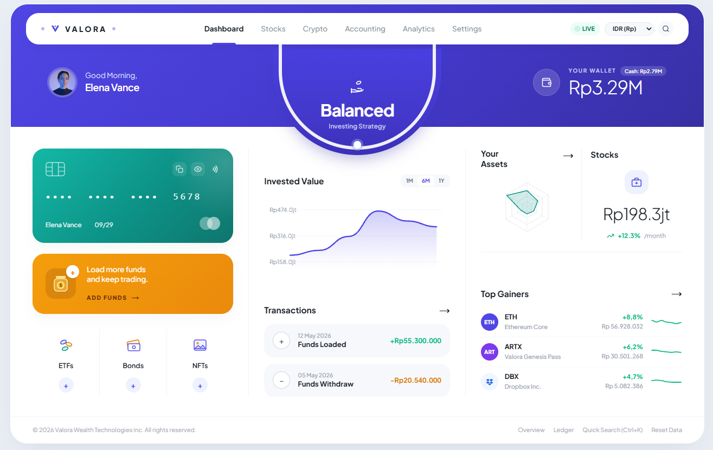

# Valora Dashboard

Template frontend untuk dashboard investasi multi-aset. Jelajahi portofolio, dompet virtual, transaksi, dan analitik tanpa login atau backend.

**[Buka demo di GitHub Pages →](https://laluarifta.github.io/valora-dashbaoard/)**



> Semua saldo, harga, kartu, dan transaksi adalah data simulasi. Perubahan tersimpan hanya di browser yang digunakan. Jangan masukkan data keuangan asli.

## Jalankan lokal

Gunakan Node.js 24 LTS (minimum 22.12) dan npm.

```bash
npm ci
npm run dev
```

Untuk memeriksa versi produksi:

```bash
npm run build
npm run preview
```

## Struktur template

```text
index.html                 # Markup dashboard, tabel, dan dialog
src/
├── main.js                # Interaksi, grafik, penyimpanan lokal, dan simulasi
├── data/demo-data.js      # Profil awal, portofolio, transaksi, dan kurs simulasi
├── styles/dashboard.css  # Gaya dashboard dan pengaturan responsif
└── assets/demo-avatar.jpg # Avatar profil demo
docs/images/               # Gambar preview README
.github/workflows/pages.yml # Build dan publikasi GitHub Pages
```

Ubah data awal di `src/data/demo-data.js` dan warna tema Tailwind di `tailwind.config.js`. Jika sudah pernah menjalankan demo, gunakan **Reset Data** untuk memuat kembali data awal.

## Publikasikan salinan

1. Gunakan **Use this template** di GitHub atau klon repo.
2. Di repo tujuan, buka **Settings → Pages** dan pilih **GitHub Actions** sebagai sumber. Jalankan workflow **Deploy GitHub Pages** atau push ke `main` untuk memulai deploy.
3. Ganti tautan demo di README dengan URL Pages repo baru.

Build menghasilkan situs statis di `dist/` dengan jalur aset relatif. Folder tersebut juga bisa diunggah ke hosting statis lain.

Kredit: [Plus Jakarta Sans](https://fontsource.org/fonts/plus-jakarta-sans) dan [foto avatar dari Unsplash](https://images.unsplash.com/photo-1534528741775-53994a69daeb).
